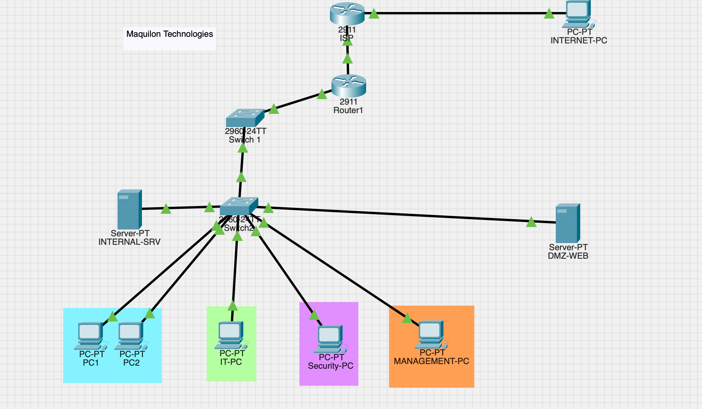

# Enterprise Network Security Lab

**Networking | Infrastructure | Cybersecurity**

## Project Overview

This project simulates an enterprise network environment using **Cisco Packet Tracer**. The goal is to practice network configuration, infrastructure administration, and security through hands-on implementation and testing.

## Project Objectives

- Design an enterprise network topology.
- Configure VLANs and trunking.
- Implement inter-VLAN routing.
- Configure DHCP for IP address assignment.
- Implement Access Control Lists (ACLs).
- Configure secure remote management using SSH.
- Implement NAT/PAT.
- Configure a DMZ web server.
- Test connectivity and troubleshoot network issues.
- Document security controls and incident response procedures.

## Technologies Used

- **Cisco Packet Tracer**
- **Cisco IOS CLI**
- **VLANs and Trunking**
- **Inter-VLAN Routing**
- **DHCP**
- **Access Control Lists (ACLs)**
- **SSH**
- **NAT/PAT**
- **DMZ Architecture**
- **GitHub Markdown**

## Network Design

The network is designed to separate devices and services into different VLANs to improve organization and security.

| VLAN | Purpose |
|---|---|
| VLAN 10 | Users |
| VLAN 20 | IT |
| VLAN 30 | Security |
| VLAN 40 | Guest |
| VLAN 50 | Servers |
| VLAN 60 | DMZ |
| VLAN 99 | Management |

**IP Addressing:** The lab uses the `10.10.x.0/24` addressing scheme for internal VLANs.

## Network Topology

The network consists of routers, switches, end devices, and servers connected to simulate an enterprise environment.

## Security Controls

The following security mechanisms are implemented and tested as part of the lab:

- **VLAN Segmentation:** Separates network devices and limits unnecessary communication.
- **Access Control Lists (ACLs):** Restricts traffic based on defined security rules.
- **SSH Management:** Enables secure remote administration of network devices.
- **NAT/PAT:** Translates internal IP addresses for external connectivity.
- **DMZ:** Isolates the public-facing web server from internal network resources.

## Configuration Evidence

Screenshots documenting the lab configuration and testing are organized below.

| Screenshot | Description |
|---|---|
| `01-network-topology.png` | Enterprise network topology |
| `02-router-configuration.png` | Router configuration |
| `03-vlan-trunking.png` | VLANs and trunking |
| `04-acl-security.png` | Access control lists |
| `05-ssh-management.png` | SSH configuration and testing |
| `06-nat.png` | NAT configuration and translations |
| `07-dmz-web-server.png` | DMZ web server and connectivity |

## Testing and Validation

Network functionality is verified through configuration checks and connectivity tests.

- **Connectivity:** Verify communication between permitted devices.
- **VLANs:** Confirm VLAN membership and trunk operation.
- **ACLs:** Verify that permitted traffic succeeds and restricted traffic is blocked.
- **SSH:** Test secure remote device management.
- **NAT:** Verify address translation during network traffic.
- **DMZ:** Test web server accessibility according to the configured security rules.

## Incident Response

The incident-response exercise will document the investigation and handling of a simulated network security incident.

1. **Identification:** Detect and investigate suspicious network activity.
2. **Containment:** Isolate affected devices or restrict suspicious traffic.
3. **Investigation:** Review configurations, logs, and network connectivity.
4. **Recovery:** Restore approved connectivity and validate network functionality.
5. **Lessons Learned:** Document findings and recommend security improvements.

## Documentation

Detailed project documentation is available in the `documentation/` directory.

- [Network Design](documentation/network-design.md)
- [Security Controls](documentation/security-controls.md)
- [Incident Response](documentation/incident-response.md)

## Key Takeaways

This project provides hands-on experience with **enterprise networking, network segmentation, security controls, troubleshooting, and technical documentation**.

It demonstrates the process of designing, configuring, testing, and documenting a simulated enterprise network.

---

**Project Status:** In Progress

